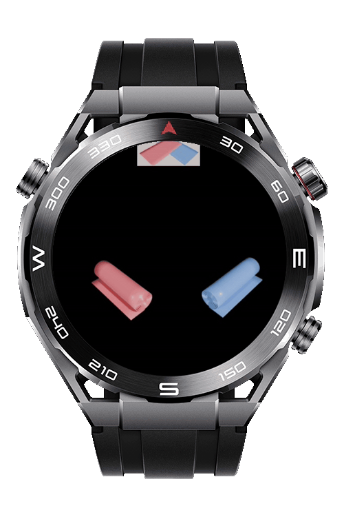
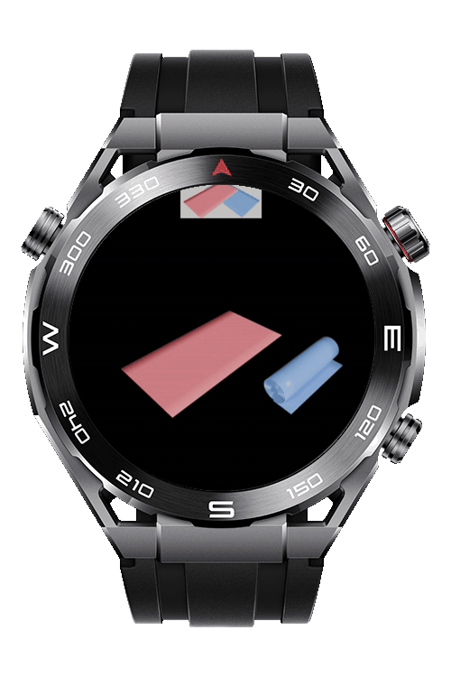
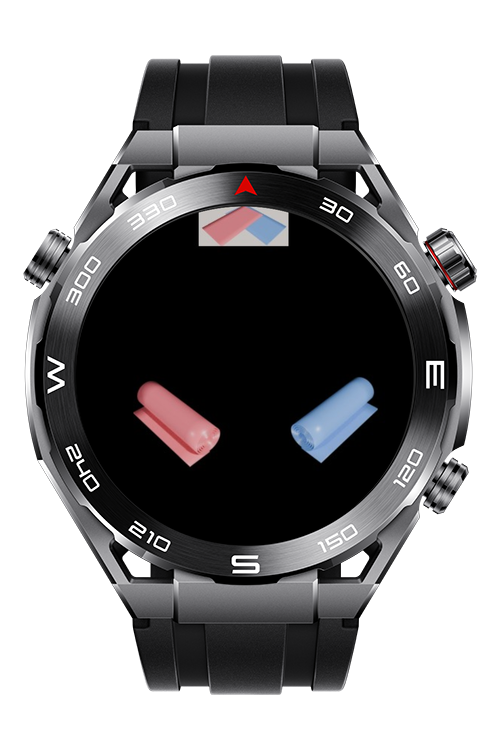
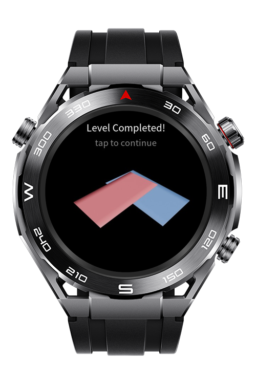

> **Note:** To access all shared projects, get information about environment setup, and view other guides, please visit [Explore-In-HMOS-Wearable Index](https://github.com/Explore-In-HMOS-Wearable/hmos-index).

# Rolling Game Lite Wearable

Rolling Game Lite Wearable is a wearable puzzle game built for HarmonyOS Lite smart watches. Players tap on paired rolling objects to toggle their state between open and closed, working to match a target configuration and complete the level.

# Preview

<div>
  
  
  
  
</div>

# Use Cases

**1. Tap to Toggle**

Players tap on a rolling object to open or close it, toggling its state between rolled and unrolled positions.

**2. Paired Interaction**

Each rolling object is linked to a pair; opening one shifts its partner to a lower depth, requiring players to consider both objects together.

**3. Target Matching**

Players must reproduce the exact target configuration by adjusting the open/close state of all rolling objects to complete the level.

**4. Level Completion**

Upon solving the puzzle, a level-completed screen appears, giving players the option to continue.

# Tech Stack

* **Languages:** JavaScript, HML, CSS
* **Platform:** HarmonyOS Lite JS
* **Frameworks:** HarmonyOS Lite JS API
* **Tools:** DevEco Studio
* **Key Component:** `image-animator`

# Constraints and Restrictions

## Supported Device

* HarmonyOS Lite wearables (sport watch)

# Directory Structure

```
entry/src/main/js/MainAbility/
├── app.js
├── common/
│   └── assets/
│       ├── _target.png
│       ├── colorroll3d_1/
│       │   └── frame_001.png ... frame_047.png
│       └── colorroll3d_2/
│           └── frame_001.png ... frame_047.png
├── i18n/
│   ├── en-US.json
│   └── zh-CN.json
└── pages/
    └── index3/
        ├── index.css
        ├── index.hml
        └── index.js
```

# LICENSE

**Rolling Game Lite Wearable** is distributed under the terms of the MIT License.
See the [LICENSE](/LICENSE) for more information.
